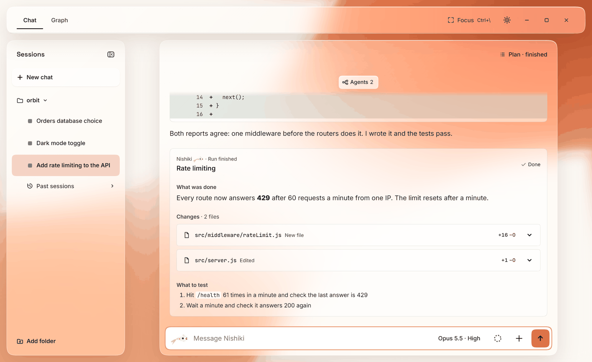
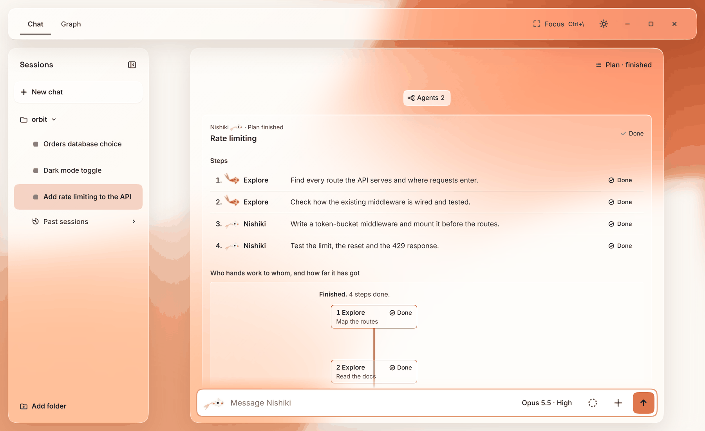
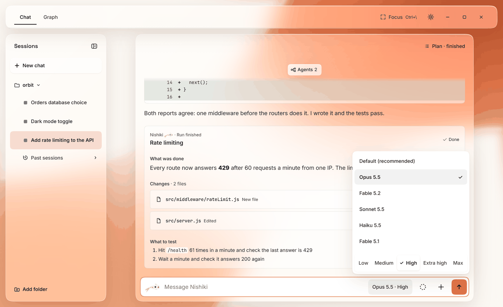

  

<h1 align="center">Nishiki</h1>

The agent harness for Claude Code.

  
  

<picture>
  <source media="(prefers-color-scheme: dark)" srcset="docs/images/hero-dark.png">
  
</picture>

Nishiki is a desktop app for Claude Code. Claude Code runs underneath, so your CLAUDE.md files, skills, hooks, plugins, MCP servers and permission rules work just as they do in the terminal. Nishiki puts a window around it: plans, questions and permission requests show up as cards, and you get a graph of notes and a live view of every subagent.

## Install

1. Download `Nishiki-Setup-<version>.exe` from the [latest release](https://github.com/Marlve/nishiki/releases/latest) and run it.
2. Open **Settings › Account** and sign in with your Claude account.
3. Add a folder in the sidebar and start a chat.

> [!NOTE]
> Claude Code comes with Nishiki, so you don't install it separately. Sign-in runs Claude Code's own `claude auth login`, and Nishiki never sees your credentials. Nishiki updates itself.

## Features

### Plans you approve

In Plan mode, Claude works read-only and then shows its steps as a card. Each step says who does it, and a diagram shows how the steps connect. You can approve, edit or reject the plan before any file changes. Switch between Plan and Auto with `Alt+M`.

### Subagents you can see

**Agents** shows every subagent and background command: who started it, what it was asked and what it called. You can stop any of them from there.

### Notes that last

Claude saves what it learns as markdown notes kept outside your repo, and every worktree of the repo shares them. Each message brings back the notes that match it. The **Graph** tab draws how the notes link.

### Run summaries

A turn that changes files ends with a short card: what was done, the diffs, and what to test.

### Terminal and Editor

Real shells and a code editor sit in tabs next to the chat. Press `Ctrl+O` on the Editor tab to jump to a file.

### Model, effort and themes

Pick the model and effort for each chat from the composer. Appearance comes in light, dark or system mode, with eight koi colours.

| | |
| --- | --- |
|  |  |

## Keyboard

| Keys | Does |
| --- | --- |
| `Ctrl+N` | New chat in this folder |
| `Alt+M` | Switch Plan and Auto |
| `Esc` | Stop the turn |
| `Ctrl+1` to `Ctrl+4` | Chat, Graph, Terminal, Editor |
| `Ctrl+\` | Focus mode |

You can change any of these in **Settings › Keybinds**.
