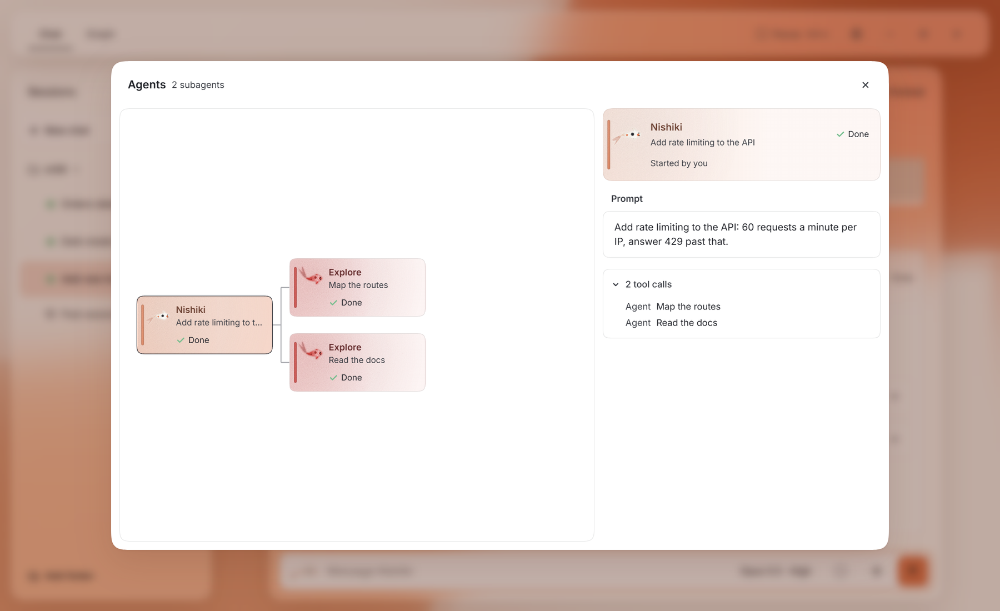
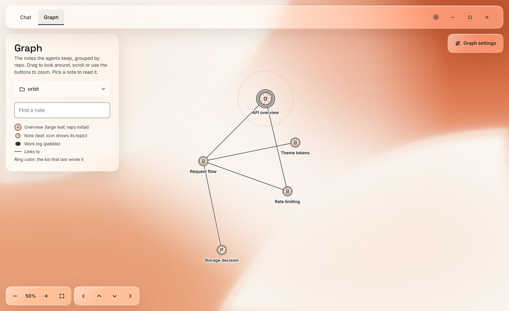
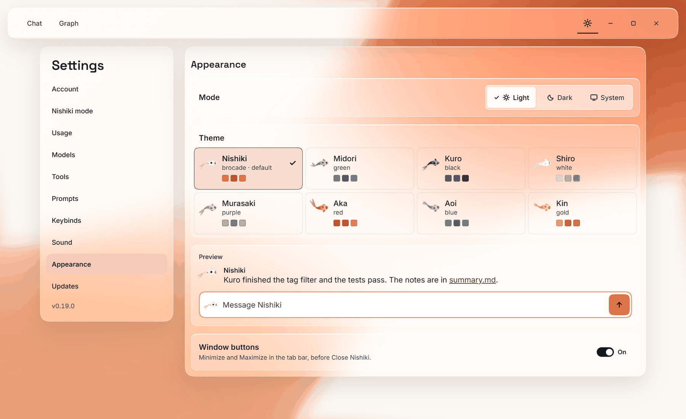

# Nishiki

A desktop app for Claude, built on the Claude Agent SDK. Plans you can read, notes that last, and subagents you can see.

<picture>
  <source media="(prefers-color-scheme: dark)" srcset="docs/images/hero-dark.png">
  
</picture>

## What it is

Nishiki runs Claude Code underneath, so your CLAUDE.md files, skills, hooks, plugins, MCP servers and permission rules all work as they do in the terminal. Nishiki adds a window around it: cards for plans, questions and permissions, a graph of notes, and a live view of the subagents Claude starts.

- **Plans as cards.** In Plan mode Claude proposes steps, who does each one, and a diagram of how they connect. You approve, edit or reject before anything changes.
- **Notes that last.** Claude writes what it learns as markdown notes, and each message recalls the ones that match. The Graph tab draws them.
- **Subagents you can see.** Each subagent shows as a koi with its own panel. The agent tree shows who started whom, with each prompt and tool call.
- **Run summaries.** A turn that changed files ends with what was done, the changed files as diffs, and what to test.
- **Model and effort per chat.** Pick both from the composer.
- **Light, dark and eight koi themes.**

## Install

1. Download `Nishiki-Setup-<version>.exe` from the [latest release](https://github.com/Marlve/nishiki/releases/latest) and run it.
2. Open Nishiki, then **Settings › Account** and sign in. Nishiki never holds your credentials: it runs Claude Code's own `claude auth login`.
3. Add a folder in the sidebar and start a chat.

## Features

### Plans

Claude plans in read-only mode, then shows the steps as a card. Each step names who does it (Nishiki or a subagent type), and the diagram follows the work as steps go from To do to Now to Done. Approving saves the plan to your notes.

Switch between Plan and Auto with `Alt+M`.

### Subagents and the agent tree

Open **Agents** in a chat to see every subagent and background command, who started it, what it was asked and what it called. Running ones can be stopped from the same place.

### Notes

Notes are markdown files outside your repo, shared by every worktree of it. The Graph tab shows how they link, and Claude searches them before it plans.

### Model and effort

The composer chip shows the chat's model and effort and opens one menu for both. Settings › Models sets the default for new chats.

### Themes

Light, dark or follow the system, in eight koi colours.

## Keyboard

| Keys | Does |
| --- | --- |
| `Alt+M` | Switch Plan and Auto |
| `Esc` | Stop the turn |
| `Ctrl+\` | Focus mode |

Rebind them in Settings › Keybinds.
